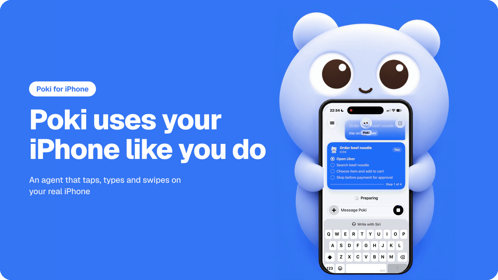
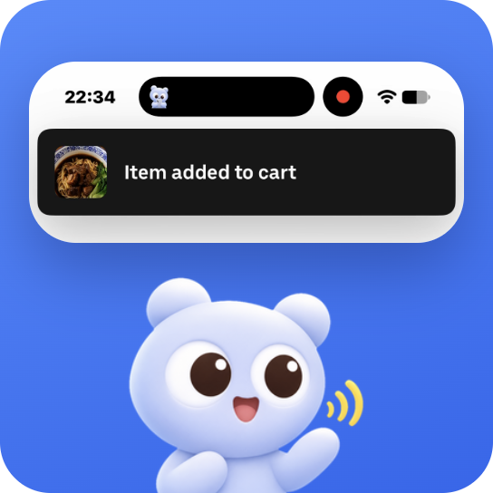

<p align="center">
  <a href="https://poki.bot"></a>
</p>

<h1 align="center">Poki usa tu iPhone como lo harías tú</h1>

<h3 align="center">Copia este prompt y envíaselo a tu agente de código</h3>

```text
Install Poki on my iPhone from https://github.com/JosssphZhou/poki
```

<p align="center"><sub>Primero conecta tu iPhone por USB y desbloquéalo. Una cuenta de Apple gratuita sirve.</sub></p>

<!-- badges:start -->
<p align="center">
  <a href="https://github.com/JosssphZhou/poki/stargazers"></a>
  <a href="https://github.com/JosssphZhou/poki/releases"></a>
  
  <a href="LICENSE"></a>
</p>
<!-- badges:end -->

<p align="center">
  <a href="README.md">English</a> | <a href="README.zh-CN.md">简体中文</a> | <a href="README.zh-TW.md">繁體中文</a> | <a href="README.ja.md">日本語</a> | <a href="README.ko.md">한국어</a> | Español<br>
  <a href="https://poki.bot">poki.bot</a>
</p>

<p align="center">
  <strong>Si Poki te resulta útil, haz clic en ★ Star para apoyar el proyecto.</strong>
</p>

## Qué es Poki

Poki es un agente de código abierto para iPhone que opera todo tu iPhone por ti. La app Poki funciona directamente en el propio iPhone, lee la pantalla y toca, escribe y desplaza contenido en apps reales usando tu propia cuenta de modelo. Tú eliges cómo pide permiso; los pagos, las eliminaciones y las acciones en Wallet siempre piden confirmación.

<p align="center">
  
</p>

## Por qué Poki

<p align="center">
  
  
  
</p>

- **Evita saltar entre apps para tareas cotidianas.** Pide ayuda a Poki en el chat, mantén pulsado el botón de Acción o usa Siri para buscar en el navegador integrado, consultar el tiempo o crear una nota. En iPhone Duo, Poki trabaja en dos apps a la vez en Vista dividida.
- **Ejecuta tareas repetidas con un toque o con la voz.** En lugar de repetir los mismos pasos cada día, abre una habilidad guardada desde la pantalla de inicio o inicia una charla por voz mientras la Dynamic Island muestra cada paso.
- **Automatiza tu teléfono real sin dejar un ordenador encendido.** Tras instalarlo una vez desde Mac o Windows, Poki funciona de forma independiente en el iPhone y se detiene en la pantalla bloqueada o en la Dynamic Island cuando hace falta tu aprobación.

## Cómo usarlo

### Instala Poki en tu iPhone

1. **Instala una vez desde un Mac o PC con Windows.** Conecta y desbloquea tu iPhone por USB (sirve una cuenta gratuita de Apple) y envía a tu agente de código, como Claude Code o Codex:

   ```text
   Install Poki on my iPhone from https://github.com/JosssphZhou/poki
   ```

   También puedes descargar [Poki Setup](https://github.com/JosssphZhou/poki/releases/tag/desktop-v0.2.8) para macOS (`.dmg`) o Windows (`.exe`) y seguir la ventana.
2. **Conecta y añade tu cuenta de modelo.** Acepta **Confiar**, activa el Modo desarrollador y el Modo de automatización cuando iOS lo pida, configura una conexión externa que enrute `10.7.0.1` al propio iPhone (como LocalDevVPN, gratuita) e inicia sesión con ChatGPT Plus o Pro, o pega una clave API (Anthropic, OpenAI, Gemini, DeepSeek, OpenRouter, OpenCode Go o un servidor compatible con OpenAI).
3. **Ejecuta tu primera tarea.** Abre Poki y envía:

   ```text
   Create a new note in Notes titled "Poki Demo" with these three lines: Milk, Eggs, Coffee. Open the note when finished. Leave existing notes unchanged.
   ```

   Abre Notas después para confirmar que existe "Poki Demo" con esas tres líneas.

<details>
<summary>Requisitos, actualizaciones, preguntas frecuentes y guías</summary>

| Elemento | Requisito |
| --- | --- |
| iPhone | iOS 18 o posterior (iPhone XS, XR, SE 2.ª gen. o posterior; también iPadOS 18+). Probado en iPhones físicos con iOS 27. |
| Ordenador | Mac con macOS 14+ (Node.js 24+ para instalación con agente) o PC Windows (x64) con Apple Devices o iTunes. |
| Cable y cuenta | Cable de datos USB y cuenta de Apple. Poki Setup renueva firmas gratuitas de 7 días mientras está abierto, o inicia sesión dentro de Poki. |
| Conexión | Conexión externa que enrute `10.7.0.1` de vuelta al iPhone (LocalDevVPN, Karing o Shadowrocket). |
| Cuenta de modelo | Sesión de ChatGPT Plus/Pro, clave API (Anthropic, OpenAI, Gemini, DeepSeek, OpenRouter, OpenCode Go) o servidor compatible con OpenAI. |

- Skill para agentes y asistente de escritorio: [skill install-poki](skills/install-poki/SKILL.md) y [Poki Setup](desktop/README.md)
- Verificación, límites y canales de publicación: [Verificación](docs/verification.md) y [Canales de publicación](docs/release-channels.md)
- Herramientas anteriores desde ordenador (sin nuevas actualizaciones): [Poki MCP y Poki Agent](docs/poki-mcp.md)

</details>

- Instalación completa, actualizaciones, preguntas frecuentes, límites y hoja de ruta: [Guía de Poki para iPhone](docs/iphone-guide.es.md)
- Registro de cambios: [CHANGELOG.md](CHANGELOG.md)

## Comunidad

- **Dudas e ideas:** Únete a [GitHub Discussions](https://github.com/JosssphZhou/poki/discussions).
- **Errores y sugerencias:** Abre un issue en [GitHub Issues](https://github.com/JosssphZhou/poki/issues).
- **Contribuir:** Consulta [CONTRIBUTING.md](CONTRIBUTING.md).

Consulta la lista de colaboradores en [CONTRIBUTING.md](CONTRIBUTING.md#contributors).

<br>

<p align="center"></p>

<p align="center"><sub>Copyright (c) 2026 Joseph Zhou (周瑟夫) and contributors. Código abierto bajo <a href="LICENSE">AGPL-3.0-only</a>. Los recursos de marca se rigen por <a href="BRAND.md">BRAND.md</a>. Consulta <a href="docs/iphone-guide.es.md">Guía de Poki para iPhone</a>, <a href="THIRD_PARTY_NOTICES.md">THIRD_PARTY_NOTICES.md</a> y el <a href="docs/iphone-guide.es.md#descargo-de-responsabilidad">Descargo de responsabilidad</a>.</sub></p>
