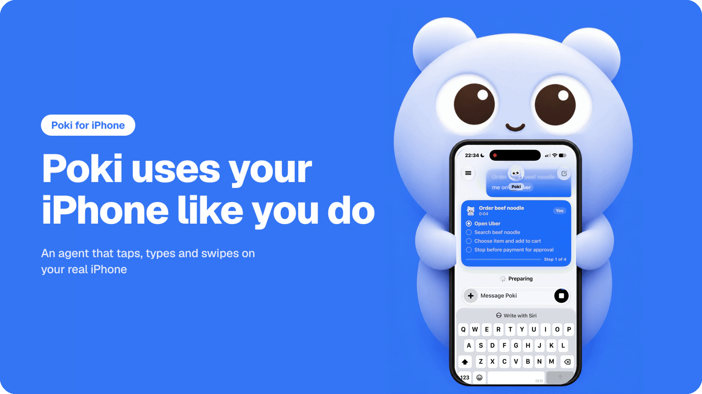
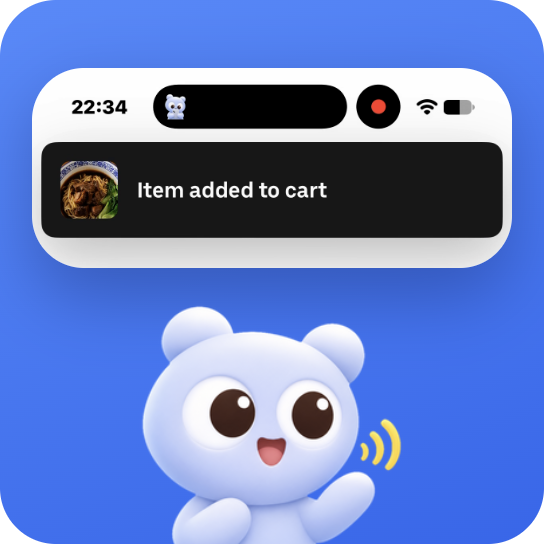

<p align="center">
  <a href="https://poki.bot"></a>
</p>

<h1 align="center">Poki は、あなたと同じように iPhone を使う</h1>

<h3 align="center">このプロンプトをコピーして、お使いのコーディングエージェントに送ってください</h3>

```text
Install Poki on my iPhone from https://github.com/JosssphZhou/poki
```

<p align="center"><sub>先に iPhone を USB で接続してロックを解除してください。無料の Apple アカウントで使えます。</sub></p>

<!-- badges:start -->
<p align="center">
  <a href="https://github.com/JosssphZhou/poki/stargazers"></a>
  <a href="https://github.com/JosssphZhou/poki/releases"></a>
  
  <a href="LICENSE"></a>
</p>
<!-- badges:end -->

<p align="center">
  <a href="README.md">English</a> | <a href="README.zh-CN.md">简体中文</a> | <a href="README.zh-TW.md">繁體中文</a> | 日本語 | <a href="README.ko.md">한국어</a> | <a href="README.es.md">Español</a><br>
  <a href="https://poki.bot">poki.bot</a>
</p>

<p align="center">
  <strong>Poki が役に立ったら、★ Star をクリックしてプロジェクトを応援してください。</strong>
</p>

## Poki とは

Poki は、あなたの代わりに iPhone 全体を操作するオープンソースの iPhone エージェントです。Poki アプリは iPhone 本体で直接動作し、画面を読み取って実際のアプリ内でタップ、文字入力、スクロールを行います。モデルアカウントはご自身のものを使用し、支払い、削除、ウォレット内の操作は常にあなたの確認を求めます。

<p align="center">
  
</p>

## なぜ Poki か

<p align="center">
  
  
  
</p>

- **日常の用事を複数のアプリを行き来せずに済ませる。** チャットで頼むか、アクションボタンの長押しや Siri から呼び出すだけで、内蔵ブラウザでの調べもの、明日の天気の確認、メモの作成を任せられます。iPhone Duo では Split View で 2 つのアプリを並べて操作できます。
- **繰り返しの操作をタップや音声ですぐ実行。** 毎回同じ手順を繰り返さなくても、ホーム画面に保存されたスキルをタップするか、音声会話で話しかけるだけで進められます。各ステップの状況は Dynamic Island に表示されます。
- **パソコンをつけっぱなしにせず実機を自動化。** Mac または Windows PC から一度インストールすれば、その後の作業にパソコンは不要です。承認が必要な操作では、ロック画面や Dynamic Island で一時停止して確認を求めます。

## 使い方

### iPhone に Poki をインストールする

1. **Mac または Windows PC から一度インストールする。** iPhone を USB で接続してロックを解除し（無料の Apple Account で構いません）、Claude Code や Codex などのエージェントに次を伝えます。

   ```text
   Install Poki on my iPhone from https://github.com/JosssphZhou/poki
   ```

   あるいは [GitHub Releases](https://github.com/JosssphZhou/poki/releases/tag/desktop-v0.2.8) から macOS 版（`.dmg`）または Windows 版（`.exe`）の Poki Setup をダウンロードして案内どおりに進めます。
2. **接続設定とモデルアカウントを追加する。** iOS の指示に従って「信頼」、デベロッパモード、オートメーションモードを有効にし、`10.7.0.1` を iPhone にルーティングする外部接続（無料の LocalDevVPN など）を設定します。続けて ChatGPT Plus/Pro でサインインするか、Anthropic、OpenAI、Gemini、DeepSeek、OpenRouter、OpenCode Go の API キー、または OpenAI 互換サーバーを登録します。
3. **最初のタスクを実行する。** Poki を開いて以下を送信します。

   ```text
   Create a new note in Notes titled "Poki Demo" with these three lines: Milk, Eggs, Coffee. Open the note when finished. Leave existing notes unchanged.
   ```

   完了後にメモアプリを開き、「Poki Demo」というタイトルと 3 行の本文が作成されていることを確認します。

<details>
<summary>動作要件、アップデート方法、よくある質問、ガイド一覧</summary>

| 項目 | 要件 |
| --- | --- |
| iPhone | iOS 18 以降（iPhone XS、XR、SE 第 2 世代以降、iPadOS 18 以降）。実機テストは iOS 27 で確認済みです。 |
| パソコン | macOS 14 以降の Mac（エージェント導入には Node.js 24 以降）、または Apple Devices / iTunes を導入した Windows PC（x64）。 |
| ケーブルとアカウント | USB データケーブルと Apple Account。無料アカウントの 7 日間署名は Poki Setup または Poki アプリ内で更新できます。 |
| 接続 | `10.7.0.1` を iPhone に戻す外部接続（LocalDevVPN、Karing、Shadowrocket）。 |
| モデルアカウント | ChatGPT Plus/Pro サインイン、API キー（Anthropic、OpenAI、Gemini、DeepSeek、OpenRouter、OpenCode Go）、または OpenAI 互換サーバー。 |

- エージェント用スキルとデスクトップアプリ：[install-poki スキル](skills/install-poki/SKILL.md) / [Poki Setup](desktop/README.md)
- 検証結果、制限事項、リリースチャネル：[検証と制限](docs/verification.md) / [リリースチャネル](docs/release-channels.md)
- 従来のパソコン連携ツール（更新終了）：[Poki MCP と Poki Agent](docs/poki-mcp.md)

</details>

- 詳細なインストール手順、更新方法、FAQ、既知の制限、ロードマップ：[Poki iPhone アプリガイド](docs/iphone-guide.ja.md)
- バージョン履歴：[CHANGELOG.md](CHANGELOG.md)

## コミュニティ

- **質問やアイデアの共有：** [GitHub Discussions](https://github.com/JosssphZhou/poki/discussions) にご参加ください。
- **バグ報告や機能リクエスト：** [GitHub Issues](https://github.com/JosssphZhou/poki/issues) からお寄せください。
- **コントリビュート：** [CONTRIBUTING.md](CONTRIBUTING.md) をご覧ください。

すべてのコントリビューターは [CONTRIBUTING.md](CONTRIBUTING.md#contributors) をご覧ください。

<br>

<p align="center"></p>

<p align="center"><sub>Copyright (c) 2026 Joseph Zhou (周瑟夫) and contributors. <a href="LICENSE">AGPL-3.0-only</a> ライセンスで公開しています。ブランド素材の扱いは <a href="BRAND.md">BRAND.md</a> をご覧ください。詳細は <a href="docs/iphone-guide.ja.md">Poki iPhone アプリガイド</a>、<a href="THIRD_PARTY_NOTICES.md">THIRD_PARTY_NOTICES.md</a>、<a href="docs/iphone-guide.ja.md#免責事項">免責事項</a> にあります。</sub></p>
