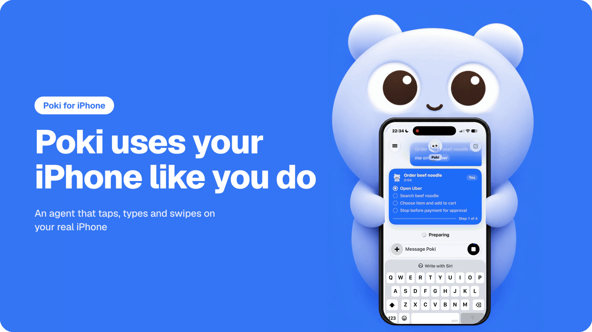
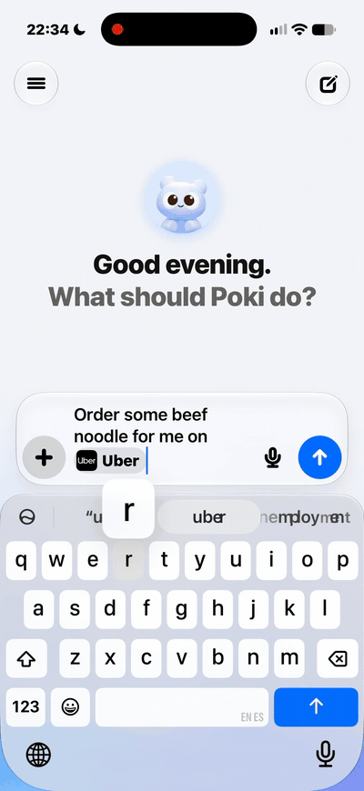

<p align="center">
  <a href="https://poki.bot"></a>
</p>

<h1 align="center">Poki는 당신의 iPhone을 당신처럼 씁니다</h1>

<h3 align="center">이 프롬프트를 복사해 코딩 에이전트에게 보내세요</h3>

```text
Install Poki on my iPhone from https://github.com/JosssphZhou/poki
```

<p align="center"><sub>먼저 USB로 iPhone을 연결하고 잠금을 해제하세요. 무료 Apple 계정이면 됩니다.</sub></p>

<!-- badges:start -->
<p align="center">
  <a href="https://github.com/JosssphZhou/poki/stargazers"></a>
  <a href="https://github.com/JosssphZhou/poki/releases"></a>
  
  <a href="LICENSE"></a>
</p>
<!-- badges:end -->

<p align="center">
  <a href="README.md">English</a> | <a href="README.zh-CN.md">简体中文</a> | <a href="README.zh-TW.md">繁體中文</a> | <a href="README.ja.md">日本語</a> | 한국어 | <a href="README.es.md">Español</a><br>
  <a href="https://poki.bot">poki.bot</a>
</p>

<p align="center">
  <strong>Poki가 도움이 되었다면 ★ Star를 클릭해 프로젝트를 응원해 주세요.</strong>
</p>

## Poki란 무엇인가요

Poki는 사용자를 대신해 iPhone 전체를 조작하는 오픈소스 iPhone 에이전트입니다. Poki 앱은 iPhone에서 직접 실행되며, 사용자의 모델 계정으로 화면을 읽고 실제 앱에서 탭, 입력, 스크롤을 수행합니다. 승인 방식은 직접 선택할 수 있으며 결제, 삭제, Wallet 작업은 항상 확인을 받습니다.

<p align="center">
  
</p>

## 왜 Poki인가요

<p align="center">
  
  
  
</p>

- **일상적인 작업을 위해 여러 앱을 번갈아 누를 필요가 없습니다.** 채팅으로 부탁하거나 동작 버튼을 길게 누르고 Siri를 호출해 내장 브라우저 검색, 내일 날씨 확인, 메모 작성을 맡길 수 있습니다. iPhone Duo에서는 Split View로 두 앱을 나란히 조작합니다.
- **반복 작업을 탭 한 번이나 음성으로 실행합니다.** 매일 같은 단계를 되풀이하는 대신 홈 화면에 저장된 스킬을 탭하거나 음성 대화를 시작하세요. 각 단계의 진행 상황은 Dynamic Island에 표시됩니다.
- **컴퓨터를 켜 두지 않고도 실제 iPhone을 자동화합니다.** Mac이나 Windows PC에서 한 번 설치하면 컴퓨터 없이 iPhone 단독으로 실행되며, 승인이 필요한 단계에서는 잠금 화면이나 Dynamic Island에서 멈추고 확인을 기다립니다.

## 사용 방법

### iPhone에 Poki 설치하기

1. **Mac 또는 Windows PC에서 한 번 설치합니다.** USB 케이블로 iPhone을 연결하고 잠금을 해제한 뒤(무료 Apple 계정 가능), Claude Code나 Codex 같은 코딩 에이전트에게 아래 문장을 전달하세요.

   ```text
   Install Poki on my iPhone from https://github.com/JosssphZhou/poki
   ```

   또는 [GitHub Releases](https://github.com/JosssphZhou/poki/releases)에서 macOS용(`.dmg`) 또는 Windows용(`.exe`) Poki Setup을 내려받아 안내를 따르세요.
2. **연결과 모델 계정을 설정합니다.** iOS 안내에 따라 신뢰, 개발자 모드, 자동화 모드를 켜고 `10.7.0.1`을 iPhone으로 라우팅하는 외부 연결(예: 무료 LocalDevVPN)을 설정합니다. 이어서 ChatGPT Plus/Pro로 로그인하거나 Anthropic, OpenAI, Gemini, DeepSeek, OpenRouter, OpenCode Go API 키 또는 OpenAI 호환 서버를 등록하세요.
3. **첫 작업을 실행합니다.** Poki를 열고 다음 메시지를 보냅니다.

   ```text
   Create a new note in Notes titled "Poki Demo" with these three lines: Milk, Eggs, Coffee. Open the note when finished. Leave existing notes unchanged.
   ```

   완료 후 메모 앱을 열어 "Poki Demo" 메모가 세 줄의 내용과 함께 생성되었는지 확인하세요.

<details>
<summary>요구 사항, 업데이트, 자주 묻는 질문 및 가이드</summary>

| 항목 | 요구 사항 |
| --- | --- |
| iPhone | iOS 18 이상(iPhone XS, XR, SE 2세대 이상 및 iPadOS 18+). 실제 기기 테스트는 iOS 27에서 진행했습니다. |
| 컴퓨터 | macOS 14+ Mac(에이전트 설치 시 Node.js 24+ 필요) 또는 Apple Devices / iTunes가 설치된 Windows PC(x64). |
| 케이블 및 계정 | USB 데이터 케이블과 Apple 계정. 무료 계정의 7일 서명은 Poki Setup이나 Poki 앱에서 갱신할 수 있습니다. |
| 연결 | `10.7.0.1`을 iPhone으로 돌려보내는 외부 연결(LocalDevVPN, Karing, Shadowrocket). |
| 모델 계정 | ChatGPT Plus/Pro 로그인, API 키(Anthropic, OpenAI, Gemini, DeepSeek, OpenRouter, OpenCode Go) 또는 OpenAI 호환 서버. |

- 에이전트 설치 스킬 및 데스크톱 도우미: [install-poki 스킬](skills/install-poki/SKILL.md) 및 [Poki Setup](desktop/README.md)
- 검증 기록, 제한 사항 및 릴리스 채널: [검증 및 제한](docs/verification.md) 및 [릴리스 채널](docs/release-channels.md)
- 기존 컴퓨터 연동 도구(업데이트 중단): [Poki MCP 및 Poki Agent](docs/poki-mcp.md)

</details>

- 전체 설치 안내, 업데이트, FAQ, 알려진 제한 및 로드맵: [Poki iPhone 앱 가이드](docs/iphone-guide.ko.md)
- 버전별 변경 사항: [CHANGELOG.md](CHANGELOG.md)

## 커뮤니티

- **질문 및 아이디어:** [GitHub Discussions](https://github.com/JosssphZhou/poki/discussions)에 참여해 주세요.
- **버그 제보 및 기능 제안:** [GitHub Issues](https://github.com/JosssphZhou/poki/issues)에 올려 주세요.
- **코드 기여:** [CONTRIBUTING.md](CONTRIBUTING.md)를 참고해 주세요.

모든 기여자 목록은 [CONTRIBUTING.md](CONTRIBUTING.md#contributors)를 참고하세요.

<br>

<p align="center"></p>

<p align="center"><sub>Copyright (c) 2026 Joseph Zhou (周瑟夫) and contributors. <a href="LICENSE">AGPL-3.0-only</a> 라이선스로 공개됩니다. 브랜드 자산 규정은 <a href="BRAND.md">BRAND.md</a>를 따릅니다. 자세한 내용은 <a href="docs/iphone-guide.ko.md">Poki iPhone 앱 가이드</a>, <a href="THIRD_PARTY_NOTICES.md">THIRD_PARTY_NOTICES.md</a>, <a href="docs/iphone-guide.ko.md#면책-조항">면책 조항</a>을 참고하세요.</sub></p>
