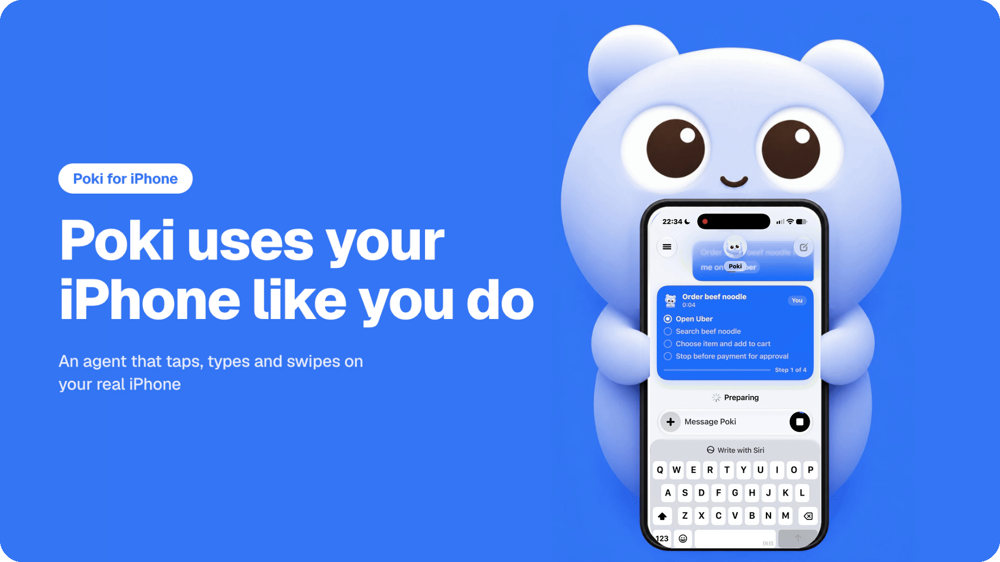
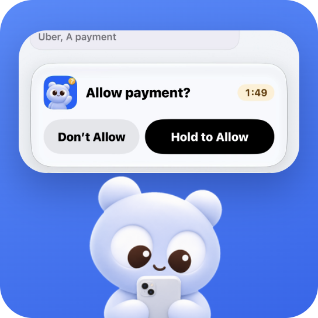

<p align="center">
  <a href="https://poki.bot"></a>
</p>

<h1 align="center">Poki 用你的 iPhone，就像你自己在用</h1>

<h3 align="center">複製這段話，傳給你的編碼代理程式</h3>

```text
從 https://github.com/JosssphZhou/poki 把 Poki 安裝到我的 iPhone 上
```

<p align="center"><sub>先用 USB 傳輸線連接並解鎖 iPhone，免費 Apple 帳號即可。</sub></p>

<!-- badges:start -->
<p align="center">
  <a href="https://github.com/JosssphZhou/poki/stargazers"></a>
  <a href="https://github.com/JosssphZhou/poki/releases"></a>
  
  <a href="LICENSE"></a>
</p>
<!-- badges:end -->

<p align="center">
  <a href="README.md">English</a> | <a href="README.zh-CN.md">简体中文</a> | 繁體中文 | <a href="README.ja.md">日本語</a> | <a href="README.ko.md">한국어</a> | <a href="README.es.md">Español</a><br>
  <a href="https://poki.bot">poki.bot</a>
</p>

<p align="center">
  <strong>如果 Poki 對你有幫助，請點擊 ★ Star 支持這個專案。</strong>
</p>

## Poki 是什麼

Poki 是開源的 iPhone agent，能替你操作整台 iPhone。Poki 應用程式直接執行在你的 iPhone 上，會讀取畫面，並在真實應用程式中點選、輸入和捲動，使用你自己的模型帳號。你可以選擇它如何徵求許可；付款、刪除和錢包中的操作始終需要你的確認。

<p align="center">
  
</p>

## 為什麼用 Poki

<p align="center">
  
  
  
</p>

- **日常瑣事不必在多個應用程式之間來回點選。** 直接在對話裡告訴 Poki，或長按動作按鈕、呼叫 Siri，就能透過內建瀏覽器查資料、查看明天天氣或建立備忘錄。在 iPhone Duo 上，Poki 還能在分割畫面中同時操作兩個應用程式。
- **重複任務點一下或說一句話就完成。** 不必每天重複相同的步驟，直接在首頁點選儲存的技能，或使用「與 Poki 對話」進行語音互動，每一步進度都會顯示在動態島上。
- **不依賴電腦持續開機，直接操作實機。** 透過 Mac 或 Windows 電腦完成一次安裝後，Poki 即可在 iPhone 上獨立執行，遇到付款、刪除或錢包操作時會在鎖定畫面或動態島暫停等待你的確認。

## 怎麼用

### 在 iPhone 上安裝 Poki

1. **透過 Mac 或 Windows 電腦完成一次安裝。** 用 USB 傳輸線連接並解鎖 iPhone（免費 Apple 帳號即可），然後將以下內容傳給你的編碼代理程式（例如 Claude Code 或 Codex）：

   ```text
   從 https://github.com/JosssphZhou/poki 把 Poki 安裝到我的 iPhone 上
   ```

   也可以從 [GitHub Releases](https://github.com/JosssphZhou/poki/releases/tag/desktop-v0.2.8) 下載 macOS 版（`.dmg`）或 Windows 版（`.exe`）Poki Setup，依視窗指示操作。
2. **完成連線並設定模型帳號。** 依 iOS 提示點選「信任」、開啟開發者模式與自動化模式，設定將 `10.7.0.1` 路由回本機的外部代理通道（例如免費的 LocalDevVPN），再用 ChatGPT Plus 或 Pro 登入，或填入 Anthropic、OpenAI、Gemini、DeepSeek、OpenRouter、OpenCode Go 的 API 金鑰，或接入 OpenAI 相容服務。
3. **執行第一個任務。** 開啟 Poki 並傳送：

   ```text
   在備忘錄中新建一則標題為“Poki Demo”的筆記，內文分三行寫 Milk、Eggs、Coffee。完成後開啟這則筆記，不修改現有筆記。
   ```

   完成後開啟備忘錄，確認標題為“Poki Demo”且內文包含這三行內容。

<details>
<summary>環境需求、更新方式、常見問題與文件索引</summary>

| 項目 | 需求 |
| --- | --- |
| iPhone | iOS 18 或更高版本（iPhone XS、XR、SE 第 2 代或更新機型；亦支援 iPadOS 18+）。實機已在 iOS 27 上測試。 |
| 電腦 | macOS 14+ 的 Mac（代理程式安裝需要 Node.js 24+），或已安裝 Apple Devices 或 iTunes 的 Windows 電腦（x64）。 |
| 傳輸線與帳號 | USB 傳輸線與 Apple 帳號。電腦開啟 Poki Setup 時可自動續簽免費 7 天簽署，也可在 Poki 內登入續簽。 |
| 連線 | 將 `10.7.0.1` 路由回 iPhone 的外部代理通道（LocalDevVPN、Karing 或 Shadowrocket）。 |
| 模型帳號 | ChatGPT Plus/Pro 登入、API 金鑰（Anthropic、OpenAI、Gemini、DeepSeek、OpenRouter、OpenCode Go）或 OpenAI 相容服務。 |

- 代理程式安裝技能與桌面工具：[install-poki 技能](skills/install-poki/SKILL.md) 與 [Poki Setup](desktop/README.md)
- 測試驗證、平台限制與發佈通道：[驗證與限制](docs/verification.md) 與 [發佈通道](docs/release-channels.md)
- 早期電腦端連線工具（已停止更新）：[Poki MCP 與 Poki Agent](docs/poki-mcp.md)

</details>

- 完整安裝細節、更新、常見問題、已知限制與路線圖：[Poki iPhone 使用指南](docs/iphone-guide.zh-TW.md)
- 版本變更紀錄：[CHANGELOG.md](CHANGELOG.md)

## 社群

- **提問與交流：** 歡迎加入 [GitHub Discussions](https://github.com/JosssphZhou/poki/discussions)。
- **問題回報與建議：** 請前往 [GitHub Issues](https://github.com/JosssphZhou/poki/issues)。
- **參與貢獻：** 請先閱讀 [CONTRIBUTING.md](CONTRIBUTING.md)。

查看所有貢獻者：[CONTRIBUTING.md](CONTRIBUTING.md#contributors)。

<br>

<p align="center"></p>

<p align="center"><sub>Copyright (c) 2026 Joseph Zhou (周瑟夫) and contributors. 依據 <a href="LICENSE">AGPL-3.0-only</a> 開源。品牌素材受 <a href="BRAND.md">BRAND.md</a> 規範。詳見 <a href="docs/iphone-guide.zh-TW.md">Poki iPhone 使用指南</a>、<a href="THIRD_PARTY_NOTICES.md">THIRD_PARTY_NOTICES.md</a> 與 <a href="docs/iphone-guide.zh-TW.md#免責聲明">免責聲明</a>。</sub></p>
